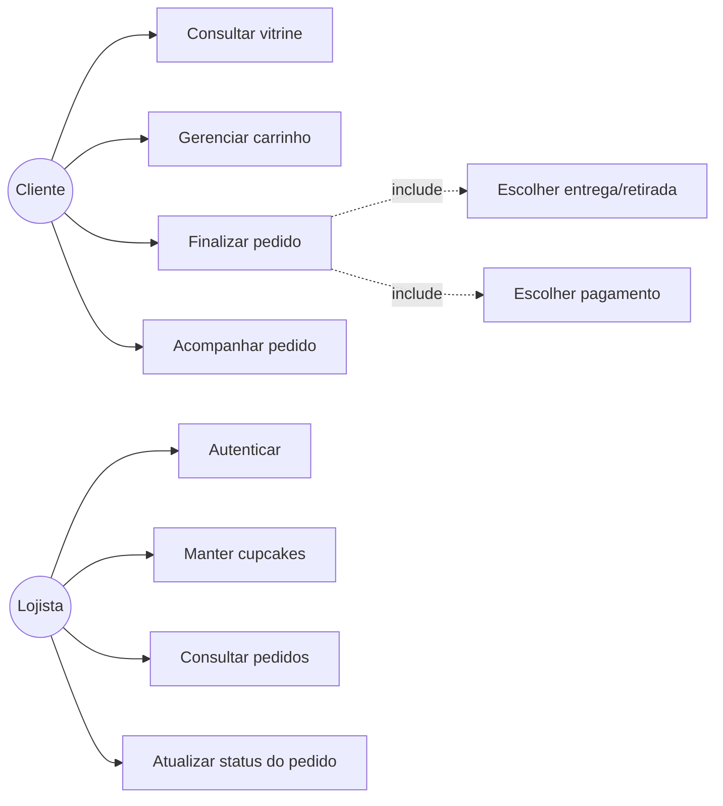
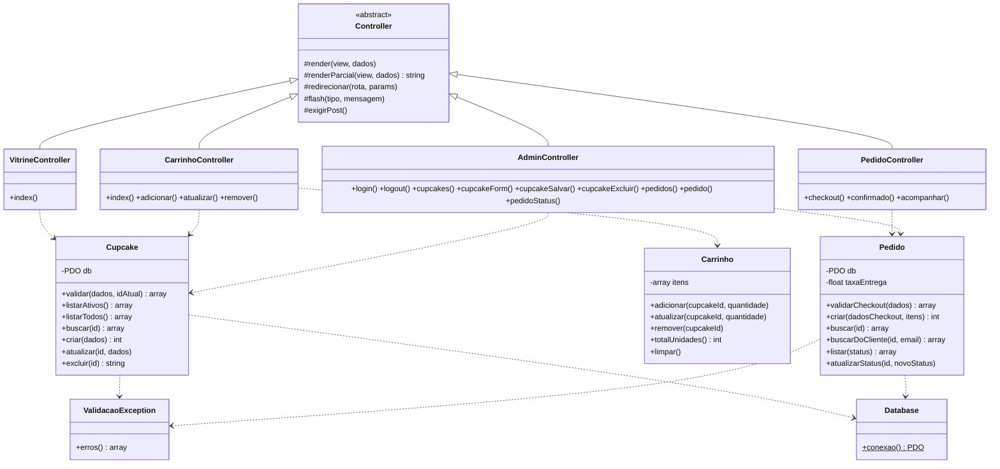
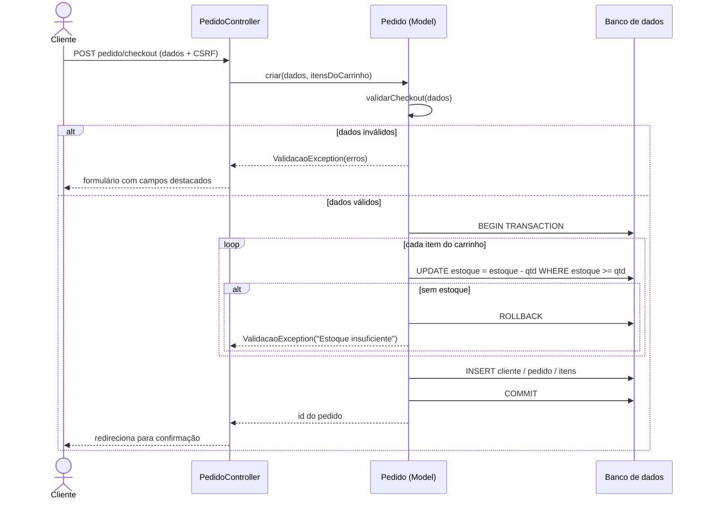
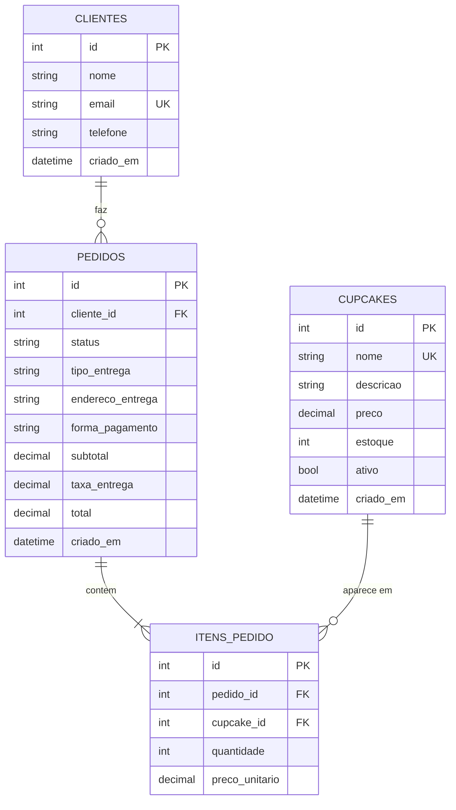

# Documentação do Projeto — Cupcakes Gourmet

Revisão (Situação 1 da PIT II) do planejamento feito na PIT I, que entregou a Especificação Ágil de Requisitos (15 Histórias de Usuário, mapa de afinidade e Product Backlog no Trello) para os pilares **vitrine virtual, pedido eletrônico, pagamento e entrega**.

## 1. Revisão do escopo

| Ponto do planejamento inicial | Decisão no projeto | Motivo |
|---|---|---|
| Aplicativo **mobile** | Aplicação **web responsiva** (funciona no navegador do celular) | Uma única base de código, publicação gratuita e sem loja de apps; atende o cliente no celular do mesmo jeito. |
| Pagamento online | Pagamento **na entrega/retirada** (PIX, cartão ou dinheiro), com chave PIX exibida na confirmação | Integração com gateway exige CNPJ, contrato e homologação — fora do prazo. Fica no backlog. |
| Cadastro com login do cliente | Cliente identificado por **e-mail** no pedido; acompanhamento por número do pedido + e-mail | Reduz atrito na compra (sem senha) e mantém a privacidade do pedido. |
| Gestão da loja | **Área do lojista** com cadastro de cupcakes e gestão de status dos pedidos | Necessária para a operação; não estava explícita no backlog original. |

**Fora do escopo desta entrega (backlog futuro):** pagamento online integrado, upload de foto dos cupcakes, notificação por e-mail/WhatsApp, cupons de desconto, avaliação de produtos, múltiplos usuários lojistas.

## 2. Histórias de usuário implementadas

| # | Eixo | História | Critérios de aceitação |
|---|---|---|---|
| HU01 | Vitrine | Como cliente, quero ver os cupcakes disponíveis com preço e descrição, para escolher o que comprar. | Só aparecem cupcakes ativos; esgotados aparecem desabilitados; ≤ 5 unidades mostra "Últimas N". |
| HU02 | Pedido | Como cliente, quero adicionar cupcakes ao carrinho, para comprar vários sabores de uma vez. | Quantidade inteira de 1 a 50; não permite mais que o estoque; mensagem de confirmação. |
| HU03 | Pedido | Como cliente, quero alterar e remover itens do carrinho, para ajustar meu pedido. | Quantidade 0 remove; subtotal recalculado. |
| HU04 | Entrega | Como cliente, quero escolher entre entrega e retirada, para receber do jeito mais conveniente. | Entrega exige endereço e cobra R$ 8,00; retirada é grátis e não pede endereço. |
| HU05 | Pagamento | Como cliente, quero escolher a forma de pagamento, para pagar como preferir. | PIX, cartão ou dinheiro; PIX mostra a chave na confirmação. |
| HU06 | Pedido | Como cliente, quero finalizar o pedido e receber um número, para ter garantia da compra. | Dados validados; total calculado no servidor; estoque baixado; número exibido. |
| HU07 | Entrega | Como cliente, quero acompanhar o status do pedido, para saber quando chega. | Consulta exige número + e-mail da compra. |
| HU08 | Gestão | Como lojista, quero cadastrar, editar e excluir cupcakes, para manter a vitrine atualizada. | Nome único (≥ 3 caracteres); preço > 0 e ≤ R$ 500 com até 2 casas; estoque inteiro ≥ 0. Com pedidos, só desativa. |
| HU09 | Gestão | Como lojista, quero ver os pedidos e filtrar por status, para organizar a produção. | Lista do mais recente para o mais antigo; filtro por status. |
| HU10 | Gestão | Como lojista, quero atualizar o status do pedido, para informar o cliente. | Pedido entregue/cancelado não muda mais; "saiu para entrega" só para entrega; cancelar devolve estoque. |

## 3. Casos de uso

## 4. Diagrama de classes (arquitetura MVC)

## 5. Diagrama de sequência — Finalizar pedido

## 6. Banco de dados

### 6.1 Modelo conceitual/lógico (normalizado até a 3FN)

Decisões:
- `itens_pedido.preco_unitario` guarda o preço **no momento da compra**; mudar o preço do cupcake depois não altera pedidos antigos.
- O endereço fica no pedido (e não no cliente), porque o mesmo cliente pode pedir para endereços diferentes.
- Restrições `CHECK` no banco reforçam as regras da aplicação (preço > 0, quantidade > 0, status válido).

### 6.2 Projeto físico
SGBD: **MySQL 8**. Script: [`sql/schema.mysql.sql`](../sql/schema.mysql.sql).

### 6.3 Dicionário de dados

**cupcakes** — produtos exibidos na vitrine

| Coluna | Tipo | Nulo | Chave | Domínio / regra |
|---|---|---|---|---|
| id | INT UNSIGNED | Não | PK | Auto incremento |
| nome | VARCHAR(100) | Não | UK | 3 a 100 caracteres, único (sem diferenciar maiúsculas) |
| descricao | VARCHAR(500) | Não | | Até 500 caracteres; padrão vazio |
| preco | DECIMAL(8,2) | Não | | > 0 e ≤ 500,00, até 2 casas decimais |
| estoque | INT UNSIGNED | Não | | Inteiro de 0 a 10.000 |
| ativo | TINYINT(1) | Não | | 1 = na vitrine, 0 = oculto |
| criado_em | DATETIME | Não | | Data/hora do cadastro |

**clientes** — quem fez pedidos

| Coluna | Tipo | Nulo | Chave | Domínio / regra |
|---|---|---|---|---|
| id | INT UNSIGNED | Não | PK | Auto incremento |
| nome | VARCHAR(100) | Não | | 3 a 100 caracteres |
| email | VARCHAR(150) | Não | UK | E-mail válido, gravado em minúsculas |
| telefone | VARCHAR(11) | Não | | Somente dígitos, 10 ou 11 (DDD + número) |
| criado_em | DATETIME | Não | | Data/hora do primeiro pedido |

**pedidos**

| Coluna | Tipo | Nulo | Chave | Domínio / regra |
|---|---|---|---|---|
| id | INT UNSIGNED | Não | PK | Número do pedido |
| cliente_id | INT UNSIGNED | Não | FK → clientes.id | |
| status | VARCHAR(30) | Não | | recebido, em_preparo, saiu_para_entrega, pronto_para_retirada, entregue, cancelado |
| tipo_entrega | VARCHAR(10) | Não | | entrega, retirada |
| endereco_entrega | VARCHAR(255) | Sim | | Obrigatório (≥ 10 caracteres) quando tipo_entrega = entrega |
| forma_pagamento | VARCHAR(10) | Não | | pix, cartao, dinheiro |
| subtotal | DECIMAL(10,2) | Não | | Soma dos itens, calculada no servidor |
| taxa_entrega | DECIMAL(8,2) | Não | | 8,00 para entrega; 0 para retirada |
| total | DECIMAL(10,2) | Não | | subtotal + taxa_entrega; > 0 |
| criado_em | DATETIME | Não | | Data/hora do pedido |

**itens_pedido**

| Coluna | Tipo | Nulo | Chave | Domínio / regra |
|---|---|---|---|---|
| id | INT UNSIGNED | Não | PK | |
| pedido_id | INT UNSIGNED | Não | FK → pedidos.id | Exclusão em cascata |
| cupcake_id | INT UNSIGNED | Não | FK → cupcakes.id | |
| quantidade | INT UNSIGNED | Não | | 1 a 50 |
| preco_unitario | DECIMAL(8,2) | Não | | Preço do cupcake no momento da compra; > 0 |

## 7. IHC — telas e mensagens

| Tela | Rota | Objetivo |
|---|---|---|
| Vitrine | `vitrine/index` | Ver sabores e adicionar ao carrinho |
| Carrinho | `carrinho/index` | Revisar, alterar quantidades, seguir para o checkout |
| Checkout | `pedido/checkout` | Dados do cliente, entrega e pagamento |
| Confirmação | `pedido/confirmado` | Número do pedido, resumo e chave PIX |
| Acompanhar pedido | `pedido/acompanhar` | Consultar status com número + e-mail |
| Login do lojista | `admin/login` | Acesso à área administrativa |
| Cupcakes (lojista) | `admin/cupcakes` / `admin/cupcakeForm` | Listar, cadastrar, editar, excluir |
| Pedidos (lojista) | `admin/pedidos` / `admin/pedido` | Listar, filtrar, abrir e mudar status |

Princípios aplicados (material da disciplina):
- **Clareza e resposta imediata:** toda ação mostra uma mensagem (verde = sucesso, vermelho = erro) e campos inválidos ficam destacados com o motivo.
- **Consistência:** mesmo layout, cores e posição dos botões em todas as telas.
- **Recuperável/reversível:** item pode ser removido do carrinho; exclusão pede confirmação; pedido pode ser cancelado (com devolução de estoque).
- **Prevenção de erros:** endereço só aparece quando "entrega" está marcada; botão "Confirmar pedido" é desabilitado após o clique (evita pedido duplicado); sabores esgotados ficam desabilitados.
- **Responsividade:** Bootstrap 5, utilizável no celular.

Mensagens de erro principais:

| Situação | Mensagem |
|---|---|
| Preço 0 ou negativo | O preço deve ser maior que zero. |
| Preço não numérico | Informe um preço válido (ex.: 9,50). |
| Nome repetido | Já existe um cupcake com esse nome. |
| Quantidade acima do estoque | Só temos N unidade(s) de [sabor]. |
| Estoque acabou durante a compra | Estoque insuficiente para [sabor] (disponível: N). |
| Entrega sem endereço | Informe o endereço completo para entrega (rua, número e bairro). |
| Pedido não encontrado | Não encontramos um pedido com esse número e e-mail. |
| Sessão expirada (CSRF) | Sua sessão expirou. Tente novamente. |
| Erro inesperado | Ocorreu um erro inesperado. Tente novamente em instantes. (detalhe técnico vai para o log do servidor) |

## 8. Segurança

- Consultas com *prepared statements* (PDO) — sem SQL injection.
- Saída de valores no html formatada com `htmlspecialchars`
- Token CSRF em todos os formulários POST.
- Total do pedido calculado no servidor com os preços do banco (o navegador não define preço).
