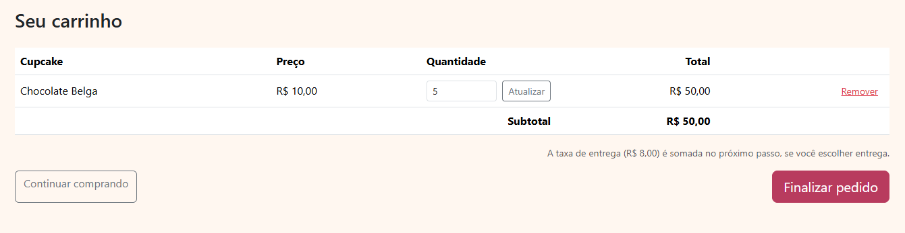
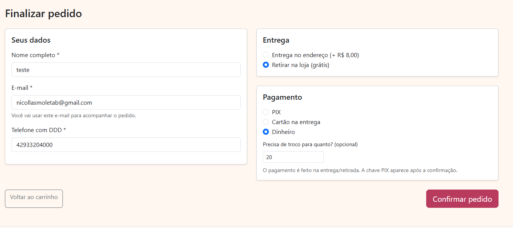
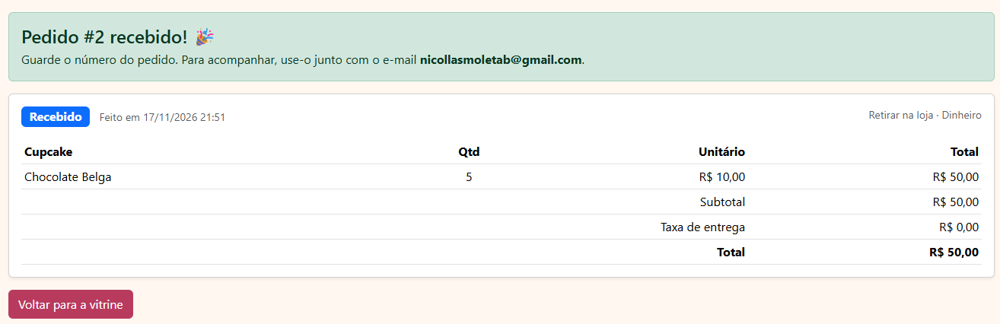
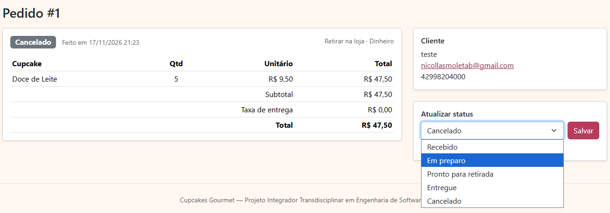
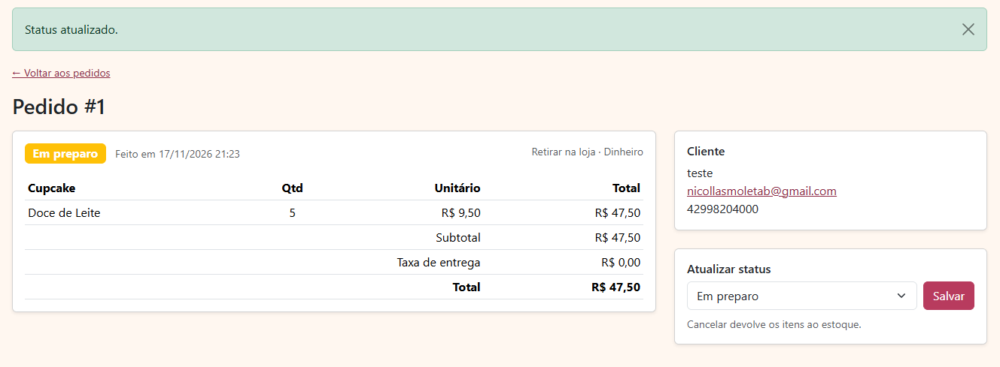

# Laudo de qualidade — Cupcakes Gourmet

Relatório elaborado após a realização dos ciclos de testes (unitários, sistema e aceitação com usuários).

## 1. Identificação

| Item | Valor |
|---|---|
| Sistema | Cupcakes Gourmet |
| Endereço testado | `http://localhost:8000` |
| Período dos testes | 09/11/2026 a 11/11/2026 |
| Testadores | 5 usuários convidados (perfil clientes e lojista) |

## 2. Resumo dos resultados

| Tipo de teste | Executados | Aprovados | Reprovados |
|---|---|---|---|
| Unitários (PHPUnit) | 6 | 6 | 0 |
| Sistema (roteiro S01–S18) | 18 | 18 | 0 |
| Aceitação (usuários) | 5 testadores | 2 sem ressalvas | 3 com ocorrências/sugestões |

---

## 3. Ocorrências encontradas e Correções

### Tabela Resumo

| ID | Relatado por | Descrição do problema | Severidade | Correção aplicada | Situação |
|---|---|---|---|---|---|
| **BUG-01** | Usuário 2 | Ao selecionar a forma de pagamento "Dinheiro na entrega", o sistema permite informar um valor de troco menor que o total do pedido. | Média | Adicionar validação no backend e frontend garantindo que o valor de troco seja estritamente superior ao valor total a pagar. | Corrigido |
| **BUG-02** | Usuário 4 | Na área do lojista, o seletor permite alterar um pedido já finalizado (Cancelado ou Entregue) de volta para "Em preparo", gerando inconsistência de estoque. | Alta | Travar a alteração no Controller/Model para status finais e desabilitar o formulário na tela do lojista caso o pedido já esteja cancelado ou entregue. | Corrigido |
| **MEL-01** | Usuário 1 | Sugestão de adicionar fotos reais dos cupcakes na vitrine em vez de utilizar apenas ícones/emojis. | Baixa | Funcionalidade registrada no backlog do projeto para implementação futura com upload de imagens no painel administrativo. | Backlog |

---

### Detalhamento das Ocorrências e Evidências

#### BUG-01: Troco inferior ao valor total do pedido
- **Descrição detalhada:** Durante a finalização de compra com pagamento em dinheiro, o usuário conseguiu preencher um valor de troco inferior ao total do pedido (ex.: total de R$ 42,00 com troco solicitado para R$ 20,00) e a compra foi confirmada normalmente sem qualquer bloqueio.
- **Evidências do problema:**

  **1. Valor do carrinho / pedido:**
  
  

  **2. Preenchimento do valor de troco inferior:**
  
  

  **3. Confirmação do pedido com sucesso mesmo com troco inválido:**
  
  

- **Correção aplicada:**
  Validação implementada no método `validarCheckout()` do Model `Pedido`, verificando se `$trocoPara !== null && $trocoPara < $total`. Caso o troco seja menor, uma `ValidacaoException` é disparada impedindo a criação do pedido e instruindo o usuário.

---

#### BUG-02: Alteração de status em pedido finalizado/cancelado
- **Descrição detalhada:** No painel administrativo do lojista, após um pedido ter sido cancelado (com os produtos já reincorporados ao estoque), o sistema ainda mantinha o seletor ativo, permitindo selecionar "Em preparo" e salvar a alteração com sucesso.
- **Evidências do problema:**

  **1. Pedido em status Cancelado:**
  
  

  **2. Status alterado de volta para Em preparo com sucesso:**
  
  

- **Correção aplicada:**
  Definição formal de `STATUS_FINAIS = ['entregue', 'cancelado']` no Model `Pedido`. Se o status atual do pedido pertencer a essa lista, qualquer tentativa de transição é rejeitada. Na View, o formulário de atualização é substituído por uma mensagem informativa quando o pedido já foi finalizado.

---

## 4. Funcionalidades não testadas

| Funcionalidade | Motivo |
|---|---|
| Pagamento com cartão online / gateway direto | Fora do escopo da entrega atual (definido pagamento na entrega/retirada). |
| Envio automático de e-mail ao cliente | Não configurado servidor SMTP em ambiente local de desenvolvimento. |

---

## 5. Conclusão

Os testes unitários e de sistema asseguraram o funcionamento dos fluxos centrais da aplicação. Os testes de aceitação com usuários cumpriram seu papel fundamental ao identificar 2 falhas pontuais de regra de negócio (BUG-01 e BUG-02). Ambas as falhas foram devidamente documentadas, corrigidas e validadas, elevando a confiabilidade do sistema para a entrega final da disciplina.
