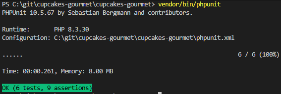

# Plano e resultados de testes

Seguindo o Modelo V do material da disciplina: testes **unitários** (PHPUnit), **de integração/sistema** (fluxo completo pelo navegador/HTTP) e [laudo](laudo-de-qualidade.md).

## 1. Testes unitários automatizados (PHPUnit)

Executar: `composer install && vendor/bin/phpunit`.

**Resultado:** Testes aprovados com sucesso.

## 2. Testes de sistema/frontend (fluxo completo via HTTP)

| # | Cenário | Esperado | Resultado |
|---|---|---|---|
| S01 | Abrir a vitrine | 6 cupcakes da carga inicial | ✅ |
| S02 | Adicionar 2 Red Velvet | Mensagem de sucesso; carrinho com 2 | ✅ |
| S03 | Adicionar quantidade 0 | Mensagem de erro; carrinho inalterado | ✅ |
| S04 | Adicionar 40 Pistache (estoque 15) | "Só temos 15 unidade(s) de Pistache." | ✅ |
| S05 | Enviar formulário com token CSRF inválido | Ação ignorada, redireciona com aviso | ✅ |
| S06 | Checkout com todos os campos inválidos | 4 mensagens nos campos corretos | ✅ |
| S07 | Checkout válido com entrega | Pedido #1, total R$ 27,00 (19,00 + 8,00) | ✅ |
| S08 | Abrir confirmação do pedido em outra sessão | 404 (não expõe pedidos alheios) | ✅ |
| S09 | Acompanhar com e-mail errado | "Não encontramos um pedido…" | ✅ |
| S10 | Acompanhar com e-mail certo (maiúsculas) | Status "Recebido" | ✅ |
| S11 | Acessar área do lojista sem login | Redireciona para o login | ✅ |
| S12 | Login com senha errada / certa | "Senha incorreta" / lista de pedidos | ✅ |
| S13 | Cancelar o pedido #1 | Status cancelado; estoque volta de 28 para 30 | ✅ |
| S14 | Cadastrar cupcake com preço 0 | "O preço deve ser maior que zero." | ✅ |
| S15 | Cadastrar cupcake "8,90" | Cadastrado | ✅ |
| S16 | Excluir cupcake que já tem pedido | Apenas desativado, com aviso | ✅ |
| S17 | Rota inexistente / id não numérico | Página 404 amigável | ✅ |
| S18 | Cadastrar nome `` | Exibido como texto (sem executar) | ✅ |

## 3. Laudo de Qualidade

Ver [laudo de qualidade](laudo-de-qualidade.md).
